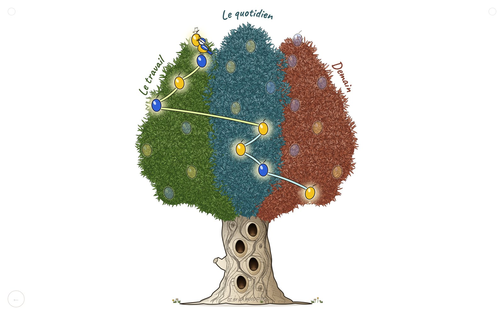

# L'Arbre à questions

**Un outil pour laisser le public guider une conférence, un atelier ou une soirée.** À chaque étape, la salle choisit entre une question jaune et une question bleue en levant un carton. Chaque choix allume un fruit dans un arbre projeté : à la fin, le chemin dessiné raconte la conversation que le groupe a voulue.

Un seul fichier HTML. Aucune installation, aucune connexion à Internet, aucun traçage.

**[▶ Essayer en ligne](https://moodstep.github.io/question-tree/)** · **[⬇ Télécharger la dernière version](https://github.com/Moodstep/question-tree/releases/latest)** · [Guide d'utilisation](docs/guide/GUIDE.md)

> **English summary.** *The Question Tree* is a single-file, offline web tool for audience-driven talks and workshops. The speaker opens with four questions, then the audience repeatedly picks between a yellow and a blue question by raising coloured cards. Each choice lights up a fruit in a hand-drawn tree projected on screen, and the final tree shows the path the group chose. Two trees (olive tree with 3 themes, oak with 4 themes), 7 interface languages (translations not yet reviewed by native speakers), a printable PDF summary of each session. No install, no internet connection, no tracking. Free, provided as is, without warranty or support. Licensed CC BY-SA 4.0.

## Essayer

1. **Pour découvrir** : ouvre la [version en ligne](https://moodstep.github.io/question-tree/). Rien à installer.
2. **Pour t'en servir devant un public** : télécharge `index.html` depuis la [dernière version](https://github.com/Moodstep/question-tree/releases/latest), puis ouvre-le dans ton navigateur (testé dans Chrome et Firefox). Il fonctionne sans Internet, même dans une salle sans réseau.
3. Choisis ton arbre, écris tes questions, lance la scène.

## Comment ça marche

| 1. Tu prépares | 2. La salle vote | 3. L'arbre raconte |
|---|---|---|
| Tu choisis un arbre et tu écris tes thèmes, 4 questions de départ et les questions soumises au vote. | Jaune ou bleue ? La salle lève un carton, tu appuies sur `J` ou `B`. | Le tableau final montre le chemin parcouru. Un PDF garde la trace de chaque session. |

## Ce que fait l'outil

- **Deux arbres** : l'olivier (3 thèmes, 23 questions, 8 votes, une mésange) et le chêne (4 thèmes, 26 questions, 7 votes, un écureuil).
- **Un éditeur** pour écrire ses questions, avec aperçu de chaque question telle qu'elle sera projetée.
- **Une scène** sobre pour la projection : rien d'autre que l'arbre et les questions, des boutons presque invisibles, un pointeur qui disparaît.
- **Des questions subsidiaires** tirées au hasard, à n'importe quel moment du parcours, parmi celles que le parcours ne proposera plus.
- **Mes arbres** : la liste de tes arbres et de leurs sessions, gardée dans le navigateur.
- **Un PDF par session** (2 pages A4) : l'arbre allumé au recto, toutes les questions au verso.
- **7 langues** d'interface : français, anglais, espagnol, allemand, italien, portugais, néerlandais. Les traductions n'ont pas encore été relues par des locuteurs natifs.

## Les touches essentielles

| Touche | Effet |
|---|---|
| `→` `Espace` `Entrée` | Étape suivante |
| `←` | Revenir d'une étape |
| `J` / `B` (ou `↑` / `↓`) | Choisir la question jaune / bleue |
| `=` ou `+` | Question subsidiaire (dès la première réponse) |
| `F` | Plein écran |
| `Maj` + `R` | Tout recommencer |
| `E` | Revenir à l'accueil |

👉 **[Le guide d'utilisation complet](docs/guide/GUIDE.md)** : chaque écran, chaque bouton, toutes les touches, avec captures annotées. Aussi en [PDF](docs/guide/guide-arbre-a-questions.pdf).

## Vie privée

Tout se passe dans ton navigateur. L'outil ne contacte aucun serveur, ne charge aucune police ni aucun script extérieur, et n'envoie rien. Tes arbres et tes sessions restent sur ton ordinateur.

La version en ligne est hébergée par GitHub Pages : comme pour toute page web, GitHub voit passer la visite. Le fichier téléchargé, lui, ne se connecte à rien.

## Pour les développeurs

L'organisation du fichier, l'ajout d'un arbre ou d'une langue et la batterie de tests sont décrits dans [docs/TECHNIQUE.md](docs/TECHNIQUE.md).

## Crédits et licence

L'Arbre à questions, conçu par [Moodstep](https://www.moodstep.com/) · arbre@moodstep.com

Pour être prévenu·e des nouvelles options et améliorations : [moodstep.com/arbre](https://www.moodstep.com/arbre/).

**Licence [CC BY-SA 4.0](https://creativecommons.org/licenses/by-sa/4.0/deed.fr)** (Creative Commons Attribution, Partage dans les mêmes conditions), pour tout l'outil : code et dessins. Tu peux l'utiliser, le modifier et le partager, à condition de créditer Moodstep, d'indiquer si tu as fait des modifications et de partager tes versions sous la même licence. La mention « CC BY-SA MOODSTEP » gravée dans le tronc fait partie du dessin et se retrouve dans tout fichier téléchargé depuis l'éditeur. Le texte juridique complet (en anglais) est dans le fichier [LICENSE](LICENSE).

Les deux polices intégrées, Caveat et Fraunces, restent sous leur propre licence, la SIL Open Font License 1.1 : voir [LICENCE-POLICES.txt](LICENCE-POLICES.txt).

**Outil fourni gratuitement, tel quel, sans garantie ni support.** Moodstep ne peut être tenu responsable de son utilisation.
