# Guide d'utilisation · L'Arbre à questions

L'Arbre à questions transforme une conférence, un atelier ou une soirée en conversation guidée par le public. Tu poses d'abord quatre questions de départ. Ensuite, à chaque étape, la salle choisit entre une question **jaune** et une question **bleue** en levant un carton. Chaque choix allume un fruit dans l'arbre projeté à l'écran : à la fin, le chemin dessiné raconte la conversation que le groupe a voulue.

L'outil tient dans **un seul fichier** (`index.html`). Il fonctionne sans Internet, sans compte et sans aucun traçage. Il suffit de l'ouvrir dans un navigateur.

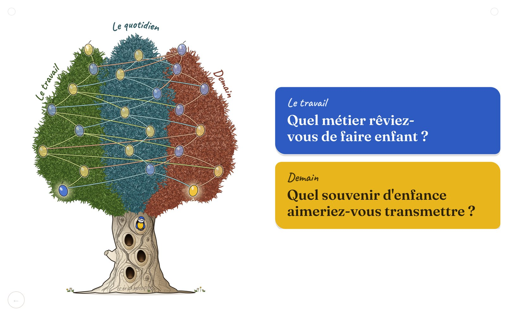

## Sommaire

1. [Le principe](#1-le-principe)
2. [Les deux arbres](#2-les-deux-arbres)
3. [L'accueil](#3-laccueil)
4. [L'éditeur : écrire ses questions](#4-léditeur--écrire-ses-questions)
5. [La scène : animer la séance](#5-la-scène--animer-la-séance)
6. [Toutes les touches du clavier](#6-toutes-les-touches-du-clavier)
7. [Les boutons discrets de la scène](#7-les-boutons-discrets-de-la-scène)
8. [Mes arbres et les sessions](#8-mes-arbres-et-les-sessions)
9. [Le PDF d'une session](#9-le-pdf-dune-session)
10. [Sauvegarder, partager, changer d'ordinateur](#10-sauvegarder-partager-changer-dordinateur)
11. [Langues](#11-langues)
12. [Conseils pour le jour J](#12-conseils-pour-le-jour-j)
13. [Questions fréquentes](#13-questions-fréquentes)

---

## 1. Le principe

L'arbre a deux parties.

- **Le tronc** : 4 questions que tu poses toi-même, dans l'ordre, pour lancer la séance. Pas de vote.
- **La ramure** (le feuillage) : les questions soumises au vote. Elles sont rangées par **thèmes**, un thème par couleur de feuillage. Chaque question est un fruit.

À chaque vote, l'écran propose deux questions, l'une jaune, l'autre bleue. Elles peuvent venir du même thème ou de deux thèmes différents. La salle lève le carton de la couleur choisie, tu appuies sur la touche correspondante, et la question choisie s'affiche en grand. Le parcours ne repasse jamais par la même question.

Une petite mascotte accompagne le groupe : elle sort du tronc, grimpe et se pose près de la question en cours.

À la fin, l'arbre s'affiche seul avec le chemin allumé. C'est le **tableau final**. La session est alors gardée automatiquement, et tu peux en tirer un PDF.

## 2. Les deux arbres

| | Olivier | Chêne |
|---|---|---|
| Thèmes | 3 | 4 |
| Questions du tronc | 4 | 4 |
| Questions de la ramure | 23 | 26 |
| Votes par séance | 8 | 7 |
| Questions posées par séance | 4 + 8 | 4 + 7 |
| Mascotte | une mésange | un écureuil |
| Fruits | des olives | des glands |

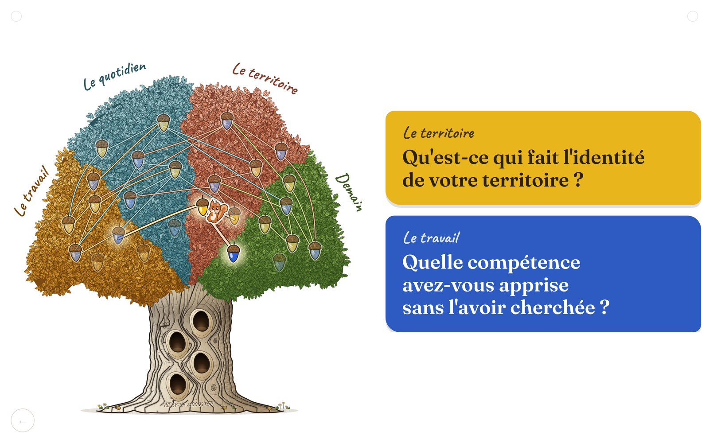

Le choix de l'arbre fixe le nombre de thèmes. **Il se verrouille dès que tu écris le premier mot** dans l'éditeur. Pour changer d'arbre ensuite, il faut repartir d'un fichier vierge.

## 3. L'accueil

C'est le premier écran, celui qui s'ouvre avec le fichier.

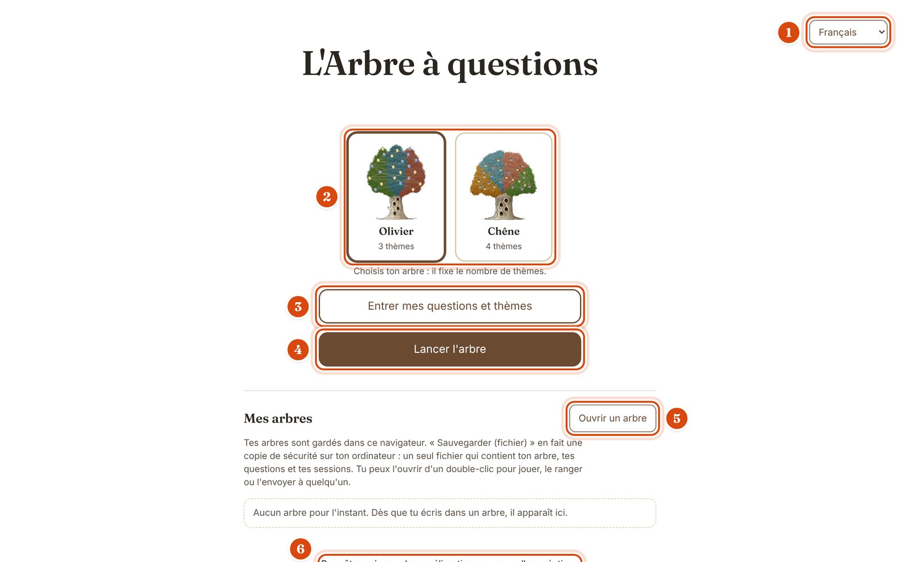

1. **Langue** : le menu en haut à droite. L'outil s'ouvre dans la langue du navigateur ; le choix fait ici est mémorisé.
2. **Choix de l'arbre** : olivier ou chêne. Le cadre foncé montre l'arbre choisi. Une fois l'écriture commencée, l'autre arbre devient pâle et ne peut plus être choisi.
3. **Entrer mes questions et thèmes** : ouvre l'éditeur.
4. **Lancer l'arbre** : ouvre la scène. S'il manque des textes, l'outil te le dit avant (voir plus bas).
5. **Ouvrir un arbre** : recharge un fichier d'arbre sauvegardé sur ton ordinateur. Il arrive directement dans l'éditeur.
6. **Pour être prévenu des améliorations** : un lien vers la page d'inscription de Moodstep.

Sous ces boutons, la section **Mes arbres** liste ce que tu as déjà construit (voir [section 8](#8-mes-arbres-et-les-sessions)).

## 4. L'éditeur : écrire ses questions

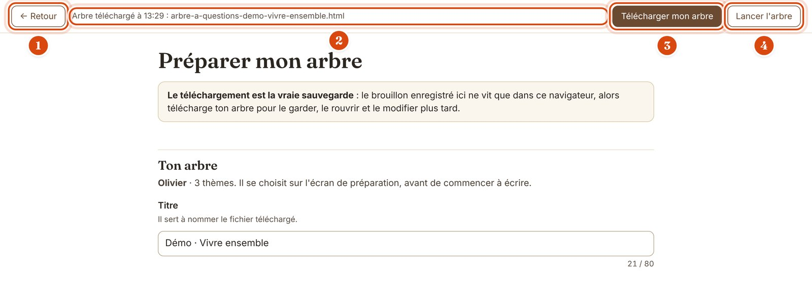

1. **← Retour** : revient à l'accueil. Rien n'est perdu.
2. **Message d'état** : il dit ce qui vient de se passer (« Brouillon enregistré dans ce navigateur à 13:22 », « Arbre téléchargé… »). Il est discret, en gris, en haut de l'écran.
3. **Télécharger mon arbre** : fabrique le fichier de ton arbre sur ton ordinateur. **C'est la vraie sauvegarde.**
4. **Lancer l'arbre** : passe directement à la scène.

L'éditeur se remplit de haut en bas :

- **Titre** (80 caractères au plus) : il nomme le fichier téléchargé et s'affiche sur l'accueil.
- **Les thèmes** : leur nom s'écrit à la main, en arc, au-dessus de chaque partie du feuillage. Chaque nom a sa propre longueur maximale, indiquée sous le champ (olivier : 30, 16 et 30 lettres ; chêne : 18, 22, 22 et 18). Un nom trop long pour son arc rétrécit au lieu d'être coupé.
- **Le tronc** : tes 4 questions de départ (160 caractères au plus).
- **La ramure** : les questions soumises au vote, rangées par thème et par niveau (120 caractères au plus).

### Une ligne de question

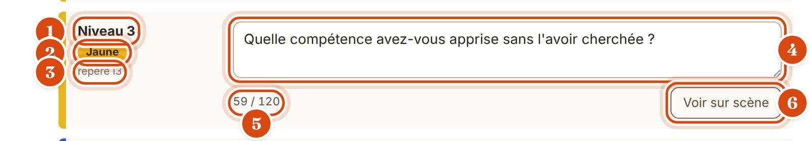

1. **Niveau** : l'étape du parcours à laquelle cette question peut être proposée (niveau 1 = premier vote).
2. **Pastille de couleur** : la couleur de la carte quand la question sera proposée au vote (jaune ou bleue). Elle est fixée par l'arbre, tu ne la choisis pas.
3. **Repère** : le code court de la question (I3, L5, A1…). Il sert à s'y retrouver, par exemple dans le message « Il manque des textes ».
4. **Le champ** : la question elle-même. Elle tient sur une seule ligne : la touche Entrée n'ajoute pas de retour à la ligne.
5. **Compteur** : nombre de caractères utilisés sur le maximum. Il change de teinte quand tu approches de la limite.
6. **Voir sur scène** : montre la question exactement comme le public la verra, avec le chemin qui y mène dans l'arbre.

### L'aperçu « Voir sur scène »

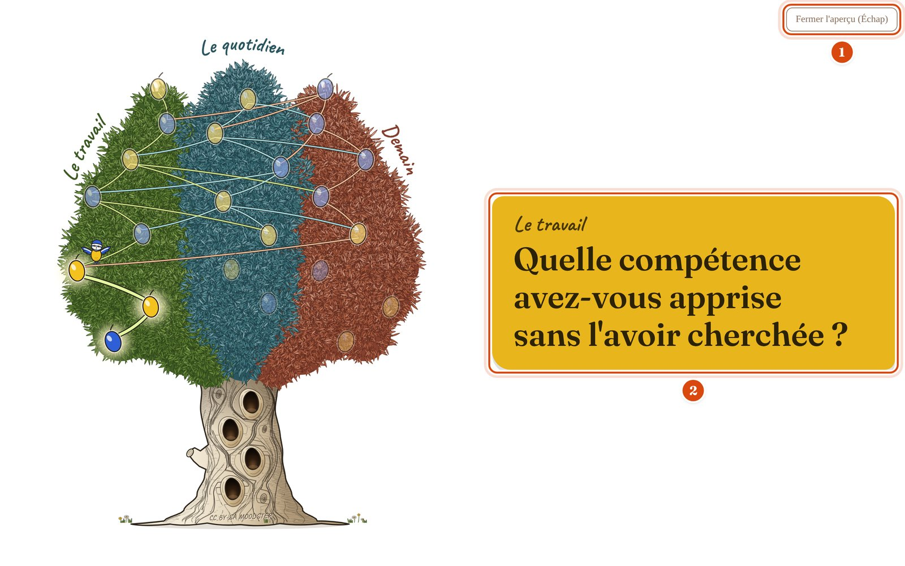

1. **Fermer l'aperçu (Échap)** : le seul bouton de cet écran. La touche `Échap` fait la même chose et te ramène à la ligne où tu étais.
2. **La carte** : la question à sa taille réelle de projection. Utile pour vérifier qu'une question longue reste lisible.

### Le brouillon automatique

Une demi-seconde après chaque frappe, l'outil enregistre un **brouillon dans le navigateur**. Si tu rouvres le fichier et qu'un brouillon plus récent existe, un bandeau te propose de **reprendre le brouillon** (ou de l'ignorer). Ce brouillon ne vit que dans ce navigateur, sur cet ordinateur. Pour garder ton arbre pour de bon, utilise **Télécharger mon arbre**.

### S'il manque des textes

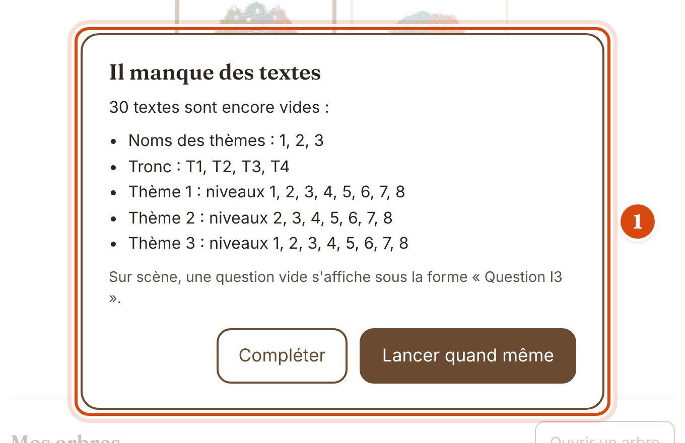

Si tu lances l'arbre alors que des champs sont vides, une fenêtre liste ce qui manque.

- **Compléter** te ramène dans l'éditeur, sur le premier champ vide.
- **Lancer quand même** ouvre la scène. Une question vide s'affiche alors sous la forme « Question I3 ». C'est pratique pour une répétition.

## 5. La scène : animer la séance

La scène est l'écran projeté. Il ne montre rien d'autre que l'arbre et les questions. Les boutons sont volontairement presque invisibles (voir [section 7](#7-les-boutons-discrets-de-la-scène)), et **le pointeur de la souris disparaît après 2,5 secondes** sans mouvement.

Appuie sur `F` (ou double-clique sur l'arbre) pour passer en plein écran.

### Étape 1 : le tronc

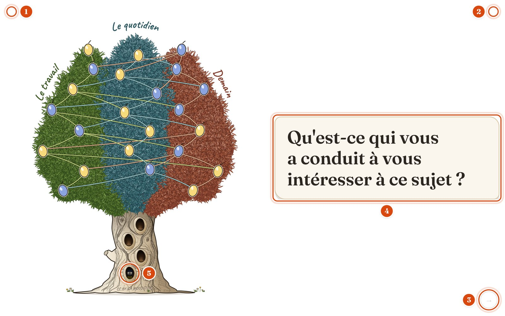

4. **La carte du tronc** : ta question de départ, sur fond crème. Avance avec `→`, `Espace` ou `Entrée`.
5. **La mascotte** attend dans une loge du tronc. Le tronc a 4 loges, une par question : elle monte d'une loge à l'autre, par l'intérieur, à chaque question.

Les boutons 1, 2 et 3 sont expliqués en [section 7](#7-les-boutons-discrets-de-la-scène).

Après la 4ᵉ question du tronc, l'appui suivant affiche le premier vote.

### Étape 2 : les votes

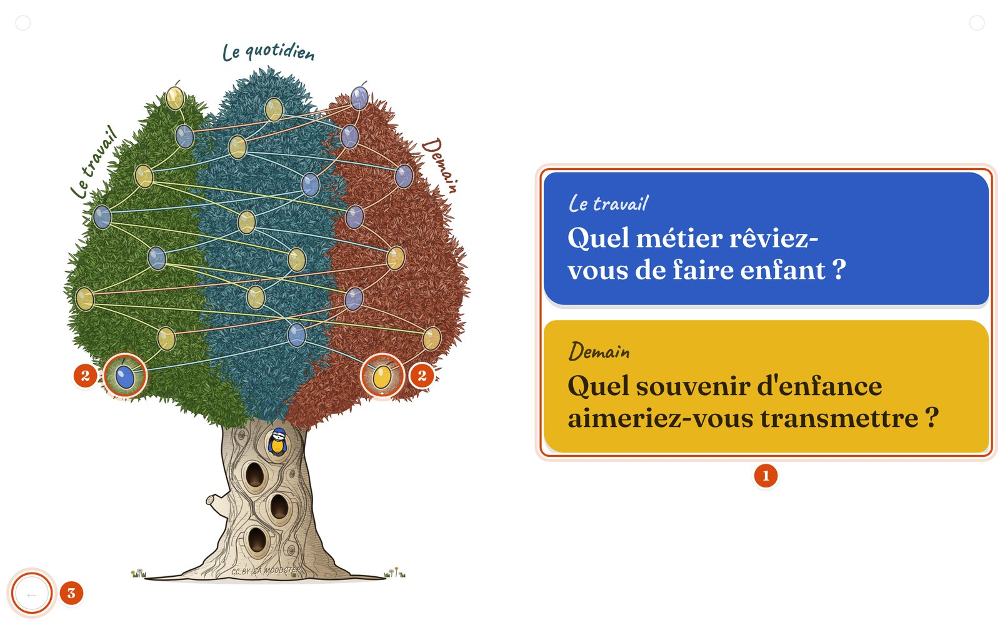

1. **Les deux cartes** : une question jaune et une question bleue, avec leur thème écrit à la main au-dessus. L'ordre (laquelle est en haut) varie d'un vote à l'autre.
2. **Les deux fruits proposés** s'allument dans l'arbre. La mascotte prend un air hésitant : elle ne désigne aucune des deux questions.
3. **←** : revenir en arrière.

Pour enregistrer le choix de la salle :

- `J` pour la question **jaune**, `B` pour la **bleue** (le plus sûr : la couleur ne dépend pas de la position) ;
- ou `↑` pour la carte **du haut**, `↓` pour la carte **du bas** ;
- ou un clic sur la carte.

Pendant un vote, `→`, `Espace` et `Entrée` ne font rien : il faut un choix. C'est voulu, pour éviter de sauter un vote par mégarde.

### Étape 3 : la réponse

La question choisie s'affiche seule, en grand, sur la couleur du vote. Le chemin se trace dans l'arbre et la mascotte vole jusqu'au fruit. Quand la réponse est terminée, `→` affiche le vote suivant.

### Étape 4 : les questions subsidiaires

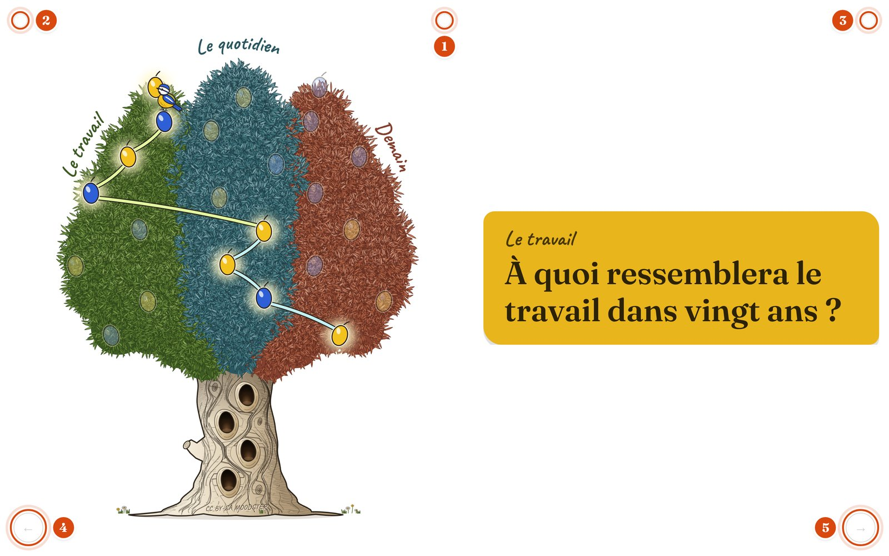

Une **question subsidiaire** est une question de plus, facultative. Tu peux la tirer **à n'importe quel moment** du parcours, dès que la salle a donné sa première réponse, et jusqu'au tableau final. Elle est tirée au hasard parmi les questions que le parcours **ne proposera plus** : celles qui ne sont pas encore apparues (ni dans le parcours, ni proposées puis refusées au vote) et qui ne peuvent plus être proposées plus loin.

Pour la tirer : la touche `=` ou la touche `+` (sur un clavier AZERTY de Mac, `+` est `Maj` + `=`), ou le **troisième petit rond, en haut au centre** (repère 1 sur l'image, ici à la dernière question). Ce rond n'apparaît que lorsqu'il y a une question à tirer : jamais pendant le tronc, ni avant la première réponse.

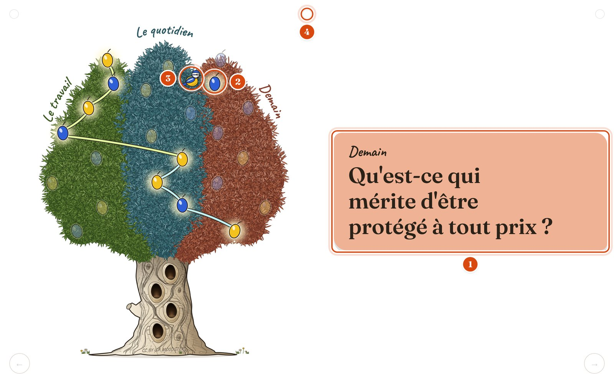

1. **La carte subsidiaire** prend la couleur du **thème** de la question (et non plus jaune ou bleu). C'est le signe visible qu'on est sorti du parcours voté.
2. **Le fruit tiré** s'allume, sans qu'aucun lien n'y mène.
3. **La mascotte** se pose à côté, tournée vers lui.
4. **Le rond du milieu** reste visible tant qu'il reste des questions à tirer.

Plus on avance dans le parcours, plus il reste de questions à tirer : en fin de parcours, il en reste 7 pour l'olivier et 12 pour le chêne. Quand il n'en reste plus, le rond disparaît.

Tu peux en tirer autant que tu veux. Ensuite :

- `←` te ramène à la subsidiaire précédente, puis **exactement là où tu en étais** dans le parcours (même carte, même mascotte, mêmes fruits allumés). Si tu appuies de nouveau sur `=`, la subsidiaire que tu viens de quitter est rejouée avant qu'une nouvelle soit tirée.
- `→` (ou `Entrée`, `Espace`) **reprend le parcours** là où il en était et avance d'un cran. À la dernière question, il passe au tableau final. Pendant un vote, il te ramène au vote : il faut choisir.

### Étape 5 : le tableau final

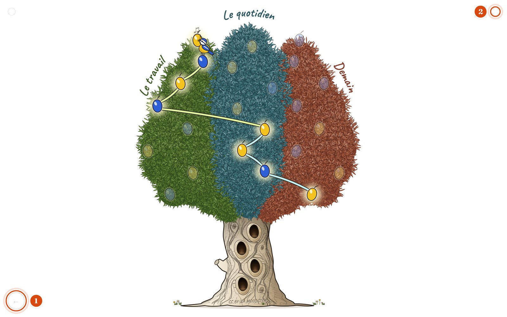

L'arbre s'affiche seul, en grand, avec tout le chemin allumé. Les questions subsidiaires n'y figurent pas : le tableau final montre le parcours voté.

1. **←** : revenir à la dernière question (ou à la dernière subsidiaire).
2. **Rond de droite** : recommencer une nouvelle séance.

**À ce moment précis, la session est gardée automatiquement** dans « Mes arbres ». Rien ne s'affiche à l'écran, puisque le public regarde.

### Quitter la scène

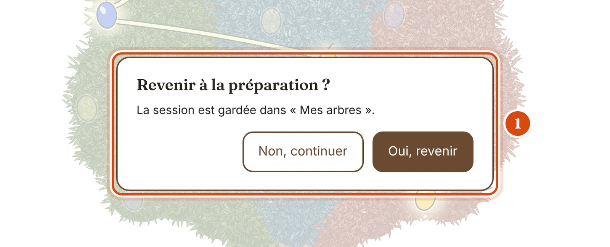

Touche `E`, ou `Échap` deux fois de suite, ou le petit rond en haut à gauche. Une fenêtre demande confirmation :

- **Non, continuer** (ou `N`) : tu restes sur la scène ;
- **Oui, revenir** (ou `O`) : retour à l'accueil.

Si la séance n'est pas allée jusqu'au tableau final, la fenêtre prévient que le parcours en cours sera perdu. Si tu étais au tableau final, elle te rassure : la session est gardée.

## 6. Toutes les touches du clavier

### Sur la scène

| Touche | Effet |
|---|---|
| `→` `Espace` `Entrée` `Page suivante` | Étape suivante (sauf pendant un vote) |
| `←` `Retour arrière` (⌫) | Revenir d'une étape |
| `J` | Pendant un vote : choisir la question **jaune** |
| `B` | Pendant un vote : choisir la question **bleue** |
| `↑` / `↓` | Pendant un vote : choisir la carte **du haut** / **du bas** |
| `1` / `2` | Comme `J` / `B` (pavé numérique, ou avec `Maj` sur un clavier AZERTY) |
| `=` ou `+` | Tirer une question subsidiaire, dès la première réponse et jusqu'au tableau final. Après un `←`, rejoue celle qu'on vient de quitter |
| `F` | Plein écran (marche / arrêt). Double-cliquer sur l'arbre fait pareil |
| `Maj` + `R` | Tout recommencer : nouvelle séance, sans confirmation |
| `E` | Revenir à l'accueil (avec confirmation) |
| `Échap` deux fois | Pareil que `E` (les deux appuis à moins d'une seconde et demie d'écart) |

Dans la fenêtre de confirmation : `O` pour oui, `N` pour non. Dans les autres langues, la lettre du « oui » suit la langue (`Y` en anglais, `S` en espagnol, italien et portugais, `J` en allemand et néerlandais).

### Ailleurs

| Où | Touche | Effet |
|---|---|---|
| Aperçu « Voir sur scène » | `Échap` | Fermer l'aperçu |
| Éditeur | `Entrée` dans une question | Rien : une question tient sur une ligne |

## 7. Les boutons discrets de la scène

Les boutons de la scène sont faits pour ne pas se voir depuis la salle. Ils sont pâles (à peine visibles). Seules les deux flèches du bas deviennent nettes quand la souris les survole : les trois petits ronds du haut restent pâles, même survolés.

| Repère | Où | Forme | Effet | Quand il est visible |
|---|---|---|---|---|
| 1 | En haut, au centre | petit rond | Tire une question subsidiaire (comme `=`) | Dès la première réponse, tant qu'il y a une question à tirer |
| 2 | En haut à gauche | petit rond | Revenir à l'accueil, avec confirmation (comme `E`) | Toujours |
| 3 | En haut à droite | petit rond | **Tout recommencer, sans confirmation** (comme `Maj` + `R`) | Toujours |
| 4 | En bas à gauche | rond avec ← | Revenir d'une étape | Sauf sur la toute première question |
| 5 | En bas à droite | rond avec → | Étape suivante | Sauf pendant un vote et au tableau final |

⚠️ **Attention au rond en haut à droite** : il recommence tout de suite, sans demander. Si la séance n'est pas arrivée au tableau final, le parcours est perdu. Si elle y est arrivée, la session est déjà gardée.

## 8. Mes arbres et les sessions

Une **session**, c'est un parcours joué jusqu'au tableau final : une conférence, un atelier, un jeu entre amis.

### Le bandeau de fin de session

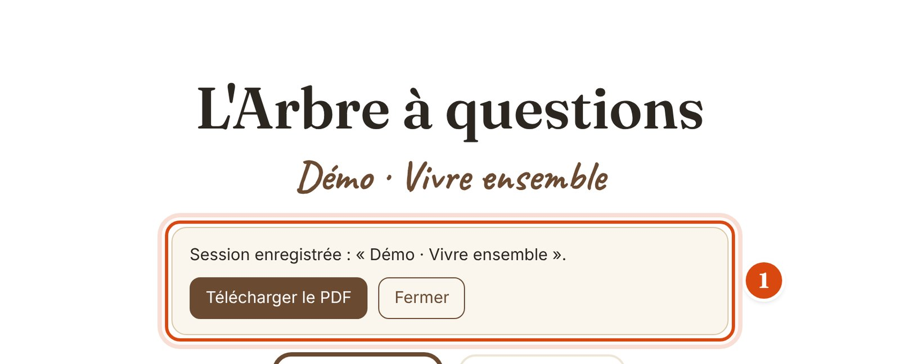

Quand tu quittes la scène après un tableau final, un bandeau apparaît en haut de l'accueil (1) : « Session enregistrée », avec **Télécharger le PDF** et **Fermer**.

### La liste « Mes arbres »

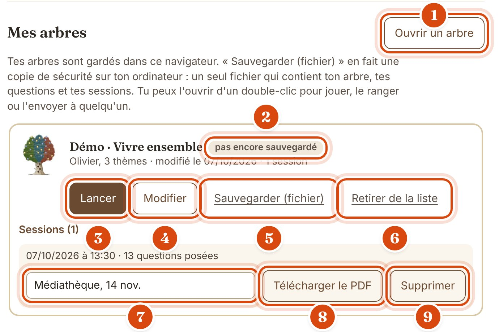

1. **Ouvrir un arbre** : recharge un fichier d'arbre depuis ton ordinateur. Il arrive dans l'éditeur. Si cet arbre est déjà dans la liste avec un contenu différent, l'outil te demande quelle version garder ; les sessions des deux côtés sont réunies dans tous les cas.
2. **Pastille d'état** : « pas encore sauvegardé » veut dire que l'arbre (ou ses sessions) a changé depuis ton dernier fichier. « brouillon, pas encore sauvegardé » veut dire qu'aucun fichier n'a jamais été fait : passe alors par **Télécharger mon arbre** dans l'éditeur.
3. **Lancer** : ouvre la scène tout de suite avec cet arbre.
4. **Modifier** : ouvre l'éditeur sur cet arbre.
5. **Sauvegarder (fichier)** : fabrique un fichier qui contient l'outil, ton arbre, tes questions **et tes sessions**. Ce bouton n'apparaît qu'après un premier téléchargement depuis l'éditeur.
6. **Retirer de la liste** : efface l'arbre et ses sessions de ce navigateur, après confirmation. Le fichier déjà sauvegardé sur ton ordinateur n'est jamais touché.
7. **Nom de la session** : donne-lui un nom (« Médiathèque, 14 nov. »). Il est enregistré quand tu quittes le champ ou appuies sur `Entrée`.
8. **Télécharger le PDF** : le compte rendu de cette session (voir section suivante).
9. **Supprimer** : efface cette session, après confirmation.

Les 3 sessions les plus récentes sont visibles. Les autres sont rangées dans un volet « Voir les *n* autres sessions ».

Bon à savoir :

- Revenir en arrière avec `←` depuis le tableau final, puis finir autrement, **met à jour la même session**.
- `Maj` + `R` (ou le rond en haut à droite) commence une **nouvelle** session.
- Un parcours abandonné avant le tableau final n'est pas gardé.
- Si tu recules dans le parcours avec `←`, les questions subsidiaires tirées plus loin sont oubliées : elles pourront être tirées de nouveau.
- Chaque session garde **une copie des textes de ce moment-là**. Si tu corriges une question ensuite, le PDF d'une session passée ne change pas.

## 9. Le PDF d'une session

Deux pages A4, à imprimer en recto-verso.

| Recto | Verso |
|---|---|
| 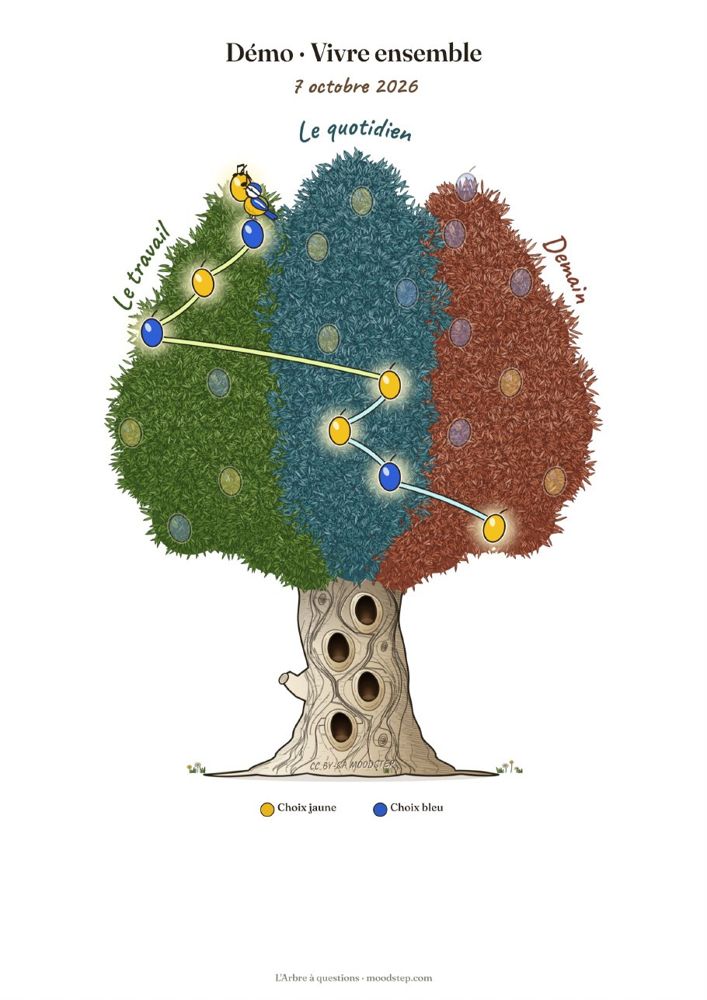 | 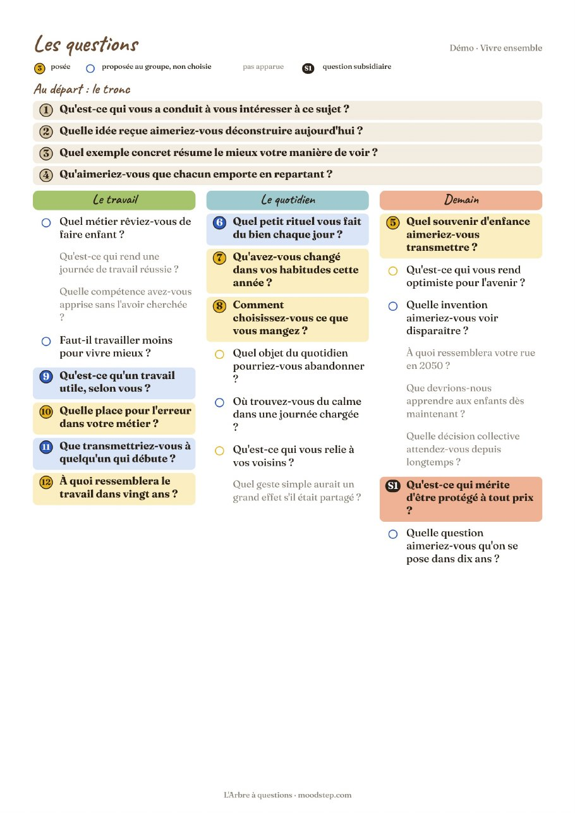 |

- **Recto** : le titre, la date, et l'arbre tel qu'il était au tableau final, chemin allumé.
- **Verso** : les 4 questions du tronc, puis une colonne par thème avec toutes les questions de l'arbre, dans trois états lisibles même en noir et blanc :
  - **posée** : numéro d'ordre dans un rond jaune ou bleu, texte en gras sur fond teinté ;
  - **proposée au groupe mais non choisie** : petit rond vide ;
  - **pas apparue** : texte gris clair.
- Les questions subsidiaires portent un repère **S1**, **S2**…

Le texte du PDF n'est pas sélectionnable : c'est un choix assumé. Il n'y a aucun bouton PDF sur la scène, puisque le tableau final est projeté.

## 10. Sauvegarder, partager, changer d'ordinateur

Il y a deux mémoires, et il faut les distinguer.

| | La mémoire du navigateur | Le fichier |
|---|---|---|
| Ce qu'elle garde | Brouillon, liste « Mes arbres », sessions | Tout : l'outil, ton arbre, tes questions, tes sessions |
| Où | Dans ce navigateur, sur cet ordinateur | Dans ton dossier Téléchargements |
| Durée | Tant que la mémoire du navigateur n'est pas vidée | Pour toujours |
| Comment | Automatique | **Télécharger mon arbre** (éditeur) ou **Sauvegarder (fichier)** (Mes arbres) |

Le fichier est la vraie sauvegarde. Il sert aussi à :

- **jouer d'un double-clic** sur un autre ordinateur, sans rien installer ;
- **envoyer ton arbre** à quelqu'un, qui pourra le rouvrir et le modifier ;
- **changer de navigateur ou d'ordinateur** : dans le nouveau navigateur, utilise **Ouvrir un arbre** ; l'arbre et ses sessions arrivent dans la liste.

Rien n'est jamais envoyé sur Internet.

## 11. Langues

L'outil existe en 7 langues : français, anglais, espagnol, allemand, italien, portugais (du Portugal) et néerlandais. Le menu est en haut à droite de l'accueil.

Ce que tu écris (titre, thèmes, questions) n'est jamais traduit. Le fichier téléchargé garde la langue choisie.

## 12. Conseils pour le jour J

- **Répète une fois en entier**, sur l'ordinateur et le vidéoprojecteur du jour : la taille du texte et les couleurs changent d'un écran à l'autre.
- **Lance le plein écran avec `F` une fois la scène ouverte**, puis vérifie que la fenêtre du navigateur est bien active : sinon les touches ne répondent pas.
- **Prépare les cartons** : un jaune et un bleu par personne.
- **Garde `J` et `B` sous les doigts** : ces touches choisissent par couleur, quelle que soit la position des cartes.
- **Une télécommande de présentation** (« clicker ») peut servir pour avancer si elle envoie `→` ou `Page suivante`. Le bouton « précédent » de ces télécommandes envoie souvent `Page précédente`, qui n'a pas d'effet ici : pour revenir en arrière, utilise `←`.
- **Sauvegarde un fichier** de ton arbre avant la séance, et emporte-le sur une clé USB.
- **Après la séance**, télécharge le PDF et donne un nom à la session.

## 13. Questions fréquentes

**Les touches ne font rien.**
Clique une fois dans la page (sans toucher un bouton) : la fenêtre du navigateur doit être active. Vérifie aussi qu'aucune fenêtre de confirmation n'est ouverte.

**J'ai appuyé sur le rond en haut à droite par erreur.**
La séance a recommencé au début. Si le tableau final avait été atteint, la session est gardée dans « Mes arbres ». Sinon, refais le parcours : avec `J` et `B`, c'est rapide.

**La touche `=` ne fait rien.**
Elle n'agit qu'à partir de la première réponse du parcours : ni pendant le tronc, ni au premier vote. Elle cesse d'agir quand il n'y a plus de question à tirer. La touche `+` fait la même chose. Sur un Mac en AZERTY, `=` se tape sans `Maj` et `+` avec `Maj`.

**Je veux changer d'arbre (olivier ↔ chêne).**
Le choix est verrouillé dès le premier mot écrit. Repars d'un fichier vierge (le fichier `index.html` d'origine).

**Ma liste « Mes arbres » a disparu.**
La mémoire du navigateur a été vidée, ou tu utilises un autre navigateur. Rouvre ton fichier avec **Ouvrir un arbre** : l'arbre et ses sessions reviennent.

**Un fichier refuse de s'ouvrir.**
L'outil vérifie chaque fichier avant de l'ouvrir. Un fichier d'une version plus ancienne ou plus récente, abîmé, ou qui n'est pas un arbre, est refusé avec un message clair. Les sessions abîmées sont ignorées, les autres sont reprises.

---

L'Arbre à questions, conçu par [Moodstep](https://www.moodstep.com/) · arbre@moodstep.com
Licence [CC BY-SA 4.0](https://creativecommons.org/licenses/by-sa/4.0/deed.fr). La mention « CC BY-SA MOODSTEP » est gravée dans le tronc de l'arbre.
